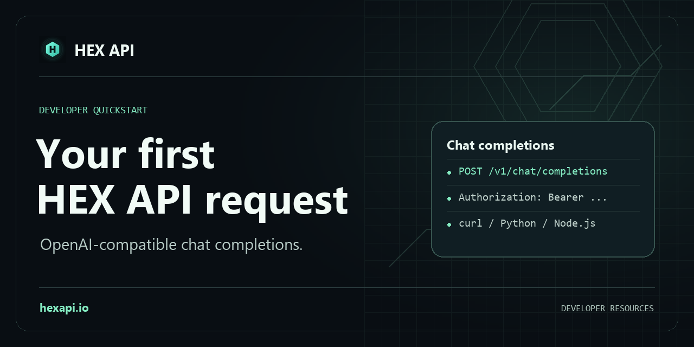

# HEX API Quickstart

Send your first chat completion to HEX using the OpenAI-compatible API. The samples use a prepaid HEX balance and read your key from the `HEX_API_KEY` environment variable.

## Find a model

Create a key in your HEX account and set `HEX_API_KEY` in your shell. Keep it on your server or development machine.

~~~bash
curl --fail-with-body https://api.hexapi.io/v1/models \
  -H "Authorization: Bearer $HEX_API_KEY"
~~~

## Make a chat request

~~~bash
curl --fail-with-body https://api.hexapi.io/v1/chat/completions \
  -H "Authorization: Bearer $HEX_API_KEY" \
  -H "Content-Type: application/json" \
  --data '{"model":"glm-5.3-abliterated","messages":[{"role":"user","content":"In one sentence, explain why a development server uses a local port."}],"max_tokens":256}'
~~~

The reply text is in `choices[0].message.content`. To use an OpenAI-compatible client, set its base URL to `https://api.hexapi.io/v1` and select an ID returned by the model list.

Run the [Python example](chat.py) with `python chat.py` or the [Node.js example](chat.mjs) with `node chat.mjs` using Node.js 22 or later. Pass a model ID as the first argument to select a different model. Each run submits a billable request.

## If a request fails

Check that the key belongs to the HEX account you intend to use, confirm the account has an available balance, and copy the model ID from the catalog. For a persistent server error, check the status page and include the time and request ID when contacting HEX support.

[API reference](https://hexapi.io/docs) · [Models](https://hexapi.io/models) · [Pricing](https://hexapi.io/pricing) · [Status](https://hexapi.io/status) · [Support](https://hexapi.io/support)
